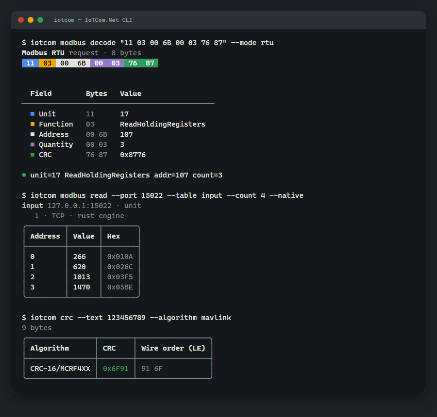

# The `iotcom` CLI

```bash
dotnet tool install -g IoTCom.Net.Cli --prerelease
iotcom --help
```



## Commands

| Command | Does |
|---|---|
| `iotcom info` | version, credits, protocol list |
| `iotcom ports` | list serial ports |
| `iotcom crc <hex> [--algorithm name] [--all] [--text ...]` | compute CRCs (23 presets, aliases like `modbus`, `x25`, `mavlink`) |
| `iotcom frame encode|decode slip|cobs|hdlc <hex>` | framing codecs |
| `iotcom modbus read` | read coils, discrete inputs, input or holding registers (`--watch`, `--float`) |
| `iotcom modbus write` | write coils or registers — requires `--allow-write` and a confirmation |
| `iotcom modbus serve` | a Modbus slave; `--simulate` runs the virtual PLC; logs every request |
| `iotcom modbus decode <frame>` | field-by-field frame lane for TCP, RTU or ASCII frames |
| `iotcom mavlink listen` / `simulate` | MAVLink log or live rate/telemetry table (`--stats`); a simulated quadcopter over UDP |
| `iotcom mavlink cmd` / `params` / `decode` | arm, takeoff, land, rtl and parameter writes (`--allow-write`); frame lane of a frame |
| `iotcom sniff tcp` / `udp` | transparent relay to a device (Modbus/TCP, HL7, CoAP, MAVLink, raw), both directions decoded, `--pcap` for Wireshark, `--lanes` for frame lanes |
| `iotcom sniff can` | passive CAN capture to the console and pcapng (SocketCAN link type) |
| `iotcom nmea listen` | live GNSS fix panel (`--raw` prints sentences) |
| `iotcom nmea simulate` | a GPS over NMEA-over-TCP |
| `iotcom can list` | SocketCAN interfaces and serial ports (slcan adapters) |
| `iotcom can dump` / `send` | candump/cansend for any backend (`--can socketcan:can0`, `slcan:COM5`, `sim`) |
| `iotcom can simulate` | engine ECU simulator behind an emulated slcan adapter on TCP |
| `iotcom uds read` / `dtc` / `raw` | UDS identification, DTCs (`--clear --allow-write`), raw requests with the frame lane |
| `iotcom obd live` / `vin` / `dtc` | OBD-II live data (`--watch`), VIN, stored and pending DTCs |
| `iotcom coap get` / `put` / `observe` / `discover` / `ping` | CoAP client on `coap://host/path` URIs (`--accept senml`, `--frames`; writes need `--allow-write`); `coaps://` runs over DTLS 1.2 with `--psk identity:hex` (or `IOTCOM_DTLS_PSK`) or `--pin <sha256>` |
| `iotcom coap serve` | simulated greenhouse node on UDP 5683; `--psk identity:hex` or `--cert` (self-signed, prints its fingerprint) serves `coaps://` on 5684 |
| `iotcom lorawan server` | light LoRaWAN network server for Semtech UDP gateways (`--devices`, `--sim` for simulated gateways and sensors, `--frames`, `--pcap`) |
| `iotcom lorawan simulate` | simulated gateways and sensors against any network server (`--server host:1700`; keys saved to a device file) |
| `iotcom dlms read` / `objects` / `profile` | DLMS/COSEM meter over HDLC (`--serial`), the wrapper (`-h`, TCP 4059) or `--sim`; `--password` or `--hls` for the management client |
| `iotcom dlms relay on\|off` / `simulate` | disconnect control (needs `--allow-write` and confirmation); a simulated meter on TCP |
| `iotcom mbus scan` / `read` / `decode` / `simulate` | M-Bus master (`--serial` 2400 8E1, `-h` gateway, `--sim`): primary scan, primary or secondary read, telegram decoding, simulated segment |
| `iotcom lorawan decode` / `airtime` | decode a PHYPayload (hex or base64; MIC and decryption with `--appkey` or `--nwkskey`/`--appskey`), time-on-air table |
| `iotcom nmea ais decode` / `watch` | decode !AIVDM sentences; live vessel table from `--sim`, `--udp <port>` or a TCP feed |
| `iotcom at send` / `info` / `sms` / `simulate` | AT-command modems over `--serial`, TCP or `--sim`; changing commands and SMS need `--allow-write` |
| `iotcom astm listen` / `send` | ASTM E1394 receiver (LIS) with `--hl7` output; synthetic analyzer results |
| `iotcom hl7 listen` | MLLP receiver with auto-ACK and decoded observations (`--raw` prints segments) |
| `iotcom hl7 send` | send an ER7 file (or a sample ORU^R01) and print the ACK |
| `iotcom hl7 simulate` | a synthetic bedside monitor (`--scenario sepsis\|hypoxia\|hypertension\|stable`) |
| `iotcom dicom listen` | DICOM Storage SCP (`--output` saves .dcm + PNG preview) |
| `iotcom dicom send` | C-STORE a file or a synthetic study (`--synthetic ct\|mr\|xray --finding …`) |
| `iotcom dicom echo` | C-ECHO verification |
| `iotcom artnet send|poll|monitor` | send DMX, discover nodes, watch universes |
| `iotcom mqtt pub|sub|broker` | publish, subscribe, run a broker |
| `iotcom ble scan` / `services` / `watch` / `write` | Bluetooth LE central on the real radio or `--sim`: advertisements (iBeacon/Eddystone decoded), GATT tree with values, notifications; `write` needs `--allow-write` |
| `iotcom usb list` / `hid` / `control` / `write` / `relay` | USB and HID devices (or `--sim`): enumeration, control IN, bulk write + read (`--allow-write`), USB HID relay boards (switching needs `--allow-write`) |
| `iotcom canopen scan` / `read` / `write` / `nmt` / `monitor` | CANopen on any `--can` URI or `sim` (two I/O modules): node scan with identity, SDO read/write (`--allow-write`), NMT (`--allow-write`), heartbeats/PDOs/emergencies |
| `iotcom j1939 monitor` / `request` / `claims` | J1939 on any `--can` URI or `sim` (an engine ECU): listen-only monitor with decoded SPNs and DM1 (`--pgn` filter), requests such as `vin`, `ci`, `hours`, `dm1` (multi-packet answers over BAM or RTS/CTS), the address/NAME table |
| `iotcom iec104 gi` / `read` / `monitor` / `command` / `serve` | IEC 60870-5-104 against `-h host` or `--sim` (a feeder bay RTU): general, group and counter interrogation, reads, spontaneous changes, commands and set points with `--sbo` (`--allow-write`), and an RTU simulator on TCP 2404 |
| `iotcom ntp query` / `serve` | NTP/SNTP: offset and delay of this computer against servers (default pool.ntp.org, `--sim` for three in-process servers, `--frames` for the frame lane; never changes the system clock), and an NTP server with stratum, reference and rate limiting |
| `iotcom nfc readers` / `read` / `write` / `decode` | NFC through PC/SC contactless readers or `--sim`: list readers, read a tag's UID, capability container and NDEF (`--dump` for every page), write a URI and text (`--allow-write`), decode NDEF bytes or a Type 2 data area |
| `iotcom lwm2m serve` / `client` / `demo` / `decode` | OMA LwM2M: a read-only server on UDP 5683 that reads every device that registers (`--observe` a path), the simulated street light against any server, an in-process demo (`--allow-write` for writes and Reboot), and a TLV decoder |
| `iotcom ocpp csms` / `charger` / `demo` / `decode` | OCPP 1.6J / 2.0.1: a read-only CSMS on `ws://0.0.0.0:8887/ocpp/{identity}` (`--tags` allow-list, `--frames`), the simulated charger against any CSMS (`--version 2.0.1`, `--password`, `--tag` starts a session), an in-process demo with an AC and a DC charger (`--allow-write` for remote start, limits and stop), and a decoder with schema check |
| `iotcom knx discover` / `monitor` / `read` / `write` / `demo` / `decode` | KNXnet/IP: find interfaces, a read-only group monitor over a tunnel (`--gateway`) or routing (`--routing`), group reads with `--dpt`, group writes (`--allow-write`, confirmation), an in-process demo, and a KNXnet/IP/cEMI decoder; `--sim` uses an in-process router with an office floor |
| `iotcom bacnet discover` / `objects` / `read` / `write` / `subscribe` / `serve` / `demo` / `decode` | BACnet/IP: Who-Is, a device's objects with names and values, property reads (`all`, array indexes), writes at a priority (`--allow-write`, confirmation, `null` relinquishes), COV subscriptions, the simulated air handling unit on UDP 47808, an in-process demo and a datagram decoder; `--sim` and `--address` |
| `iotcom matter code` / `device` / `discover` / `commission` / `read` / `onoff` / `subscribe` / `demo` / `decode` | Matter: decode or encode QR and manual codes, run a simulated light or smart-home bridge on UDP 5540 (DNS-SD with `--mdns`), browse commissionable and operational nodes, commission (`--allow-write`, `--trust-test` for simulated devices), wildcard reads, on/off/toggle (`--allow-write`), subscriptions, an in-process demo and a message/TLV decoder; the fabric lives in `--fabric` (private keys) |
| `iotcom enip discover` / `identity` / `read` / `write` / `attr` / `serve` / `demo` / `decode` | EtherNet/IP explicit messaging: ListIdentity broadcast, the Identity object, Logix tag reads (several in one Multiple_Service_Packet, `--count` for arrays), tag writes (`--allow-write`, confirmation), Get_Attribute(s), the simulated PLC on TCP/UDP 44818, an in-process demo and a decoder; `--host`, `--slot`, `--sim` |
| `iotcom ethercat interfaces` / `scan` / `watch` / `sdo` / `set` / `demo` / `decode` | EtherCAT master: raw interfaces (AF_PACKET, Npcap/libpcap), line scan with SII identity, SAFE-OP live inputs and working counters (read-only), CoE object reads and writes (`--allow-write`), one output held in OP for a few seconds (`--allow-write`, confirmation), an in-process demo and a frame decoder; `--if`, `--sim` |
| `iotcom probe list` / `info` / `read` / `flash` / `rtt` / `control` / `image` | SWD/JTAG probes through probe-rs: list probes, core state and vector table, memory dumps, flashing ELF/HEX/DFU/BIN with progress (`--allow-write`, confirmation), live RTT logs with `--send` to the down channel, halt/run/reset/erase-all (`--allow-write`), firmware file inspection and conversion to Intel HEX; `--target`, `--probe`, `--jtag`, `--sim` |
| `iotcom dfu list` / `info` / `upload` / `download` | USB DFU 1.1 and ST DfuSe: DFU devices with their memory layout, state and status, flash read-back, erase and download with `--leave` (`--allow-write`, confirmation); `--device`, `--sim` |
| `iotcom zenoh sub` / `get` / `pub` | Eclipse Zenoh: subscribe to a key expression (`plant/**`), query queryables with `get`, and publish or delete a key (`pub` needs `--allow-write` and a confirmation; `sub` and `get` are read-only). `--sim` runs an in-process network with a simulated plant; `--connect`, `--listen`, `--mode` and `--no-scouting` open a real session |
| `iotcom opcua browse` / `read` / `watch` | OPC UA client (`-e opc.tcp://…`, most secure endpoint by default, `--no-security`, `--accept-untrusted`, `--user`) or `--sim` for the in-process plant simulator; read-only sessions |
| `iotcom opcua write` / `call` / `simulate` | write a variable or call a method (need `--allow-write`; `write` asks for confirmation); run the plant simulator on TCP |
| `iotcom sparkplug watch` / `simulate` / `write` | Sparkplug B host view of a namespace (`--sim` embeds a broker and a bottling line), an edge node simulator, NCMD/DCMD writes (need `--allow-write` and confirmation) |
| `iotcom mdns browse` / `advertise` | DNS-SD discovery (all types, one type, `--watch`, `--sim`) and advertising a service with TXT properties |
| `iotcom payload <format> <hex>` | decode `protobuf`, `msgpack`, `ber-tlv`, `tlv`, `sparkplug` or `dns` payloads as a frame lane and tree |

## Connection options (Modbus)

`--host`, `--port` (TCP) · `--serial COM3 --baud 19200 --parity even` (RTU) · `--rtu`, `--ascii` · `--unit` ·
`--timeout` · `--native` (use the Rust engine).

## Recipes

```bash
# A virtual PLC in one terminal…
iotcom modbus serve --port 1502 --simulate
# …and a live view in another
iotcom modbus read --port 1502 --table input --count 8 --float --watch 1000

# What is in this frame from a logic analyzer?
iotcom modbus decode "01 03 00 00 00 0A C5 CD" --mode rtu

# Which CRC does my device use?
iotcom crc "01 03 00 00 00 0A" --all

# Watch an Art-Net universe
iotcom artnet monitor --universe 0
```

Exit codes: `0` success, `1` error, `2` invalid frame / no frame, `3` write not allowed, `4` cancelled at confirmation.
Set `IOTCOM_FORCE_ANSI=1` to keep colours when output is redirected.
